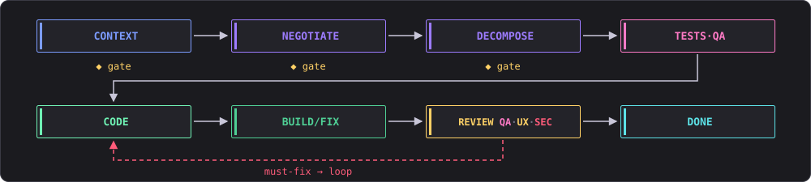
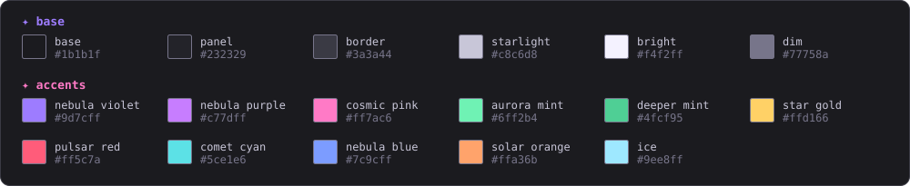

<p align="center">
  
</p>

<p align="center"><b>Decsr Code</b> — command: <code>decsr</code></p>

<p align="center">
  <a href="https://github.com/Decsr/Decsr-Code/blob/main/LICENSE"></a>
  <a href="https://github.com/Decsr/Decsr-Code/releases"></a>
  <a href="https://github.com/Decsr/Decsr-Code/actions/workflows/ci.yml"></a>
  <a href="https://github.com/Decsr/Decsr-Code/blob/main/go.mod"></a>
  <a href="https://pkg.go.dev/github.com/Decsr/Decsr-Code"></a>
</p>

<p align="center">
  <a href="#features">Features</a> ·
  <a href="#install">Install</a> ·
  <a href="#usage">Usage</a> ·
  <a href="#pipeline">Pipeline</a> ·
  <a href="#theme-galaxy--pixel">Theme</a> ·
  <a href="#docs">Docs</a>
</p>

<p align="center"></p>

## What Is It?

Decsr Code (command: `decsr`) is an open-source CLI tool written in Go that drives a team of specialized AI agents through a structured software development pipeline. Instead of chatting with a single LLM, you describe a task in plain text and DECSR runs a full **Compact → Negotiate → Decompose → Implement (TDD) → Quality Review → Fix → Done** workflow — with human approval gates before any code is written.

It ships with a rich terminal UI (built with [Bubble Tea](https://github.com/charmbracelet/bubbletea)) and also supports a headless plain-text mode for CI or scripting.

### Why DECSR

Manual back-and-forth with AI coding assistants is slow, error-prone, and hard to reproduce. DECSR:

<table>
  <tr>
    <td width="50%" valign="top">✦ <b>Structures the work</b><br>into well-defined phases so nothing gets skipped.</td>
    <td width="50%" valign="top">✦ <b>Runs multiple specialist agents</b><br>(PM, Coder, QA, UX Reviewer, Security Auditor) — each with its own prompt, skills, and model.</td>
  </tr>
  <tr>
    <td width="50%" valign="top">✦ <b>Iterates automatically</b><br>— if tests fail or reviewers find must-fix issues, the Coder fixes and the entire quality gate restarts.</td>
    <td width="50%" valign="top">✦ <b>Keeps humans in the loop</b><br>— approval gates let you review and revise the task spec and execution plan before any code is written.</td>
  </tr>
</table>

<p align="center"></p>

## Features

### 5 Specialized Agents

| Agent | Role |
|-------|------|
|  | Negotiates the task spec, decomposes work into sub-tasks, and arbitrates review feedback |
|  | Writes and fixes code, runs builds and tests |
|  | Generates tests (TDD), verifies test runs, and reviews code quality, logic, and corner cases |
|  | UX/UI heuristic review |
|  | Security audit and vulnerability scanning |

### Interactive TUI

Full-featured terminal user interface with agent panels, live token streaming, artifact viewer, chat-based revision, and project picker.

A built-in **System Monitor** (toggle with `Ctrl+T`) shows live CPU, memory, network, and per-agent token usage. Token lines use `↓` for input (prompt) tokens, `↑` for output (generated) tokens, and a trailing `~` when the count is estimated — e.g. `coder ↓33.7k ↑4.5k~`.

See [`doc/tui.md`](doc/tui.md) for a full reference of every panel, status indicator, keyboard shortcut, and token notation, with examples.

### Configurable LLM Backends

Supports multiple runners out of the box:

**CLI runners** (drive an external coding-agent CLI):

- **OpenCode** (default)
- **Claude CLI**
- **Codex CLI**
- **GitHub Copilot CLI**

**Local model backends** (talk to a local OpenAI-compatible server):

- **Ollama** (`http://127.0.0.1:11434`)
- **LM Studio** (`http://127.0.0.1:1234`)
- **MLX** (Apple Silicon, `http://127.0.0.1:8000`)

Each agent can use a different runner and model — configure globally (`~/.decsr/config.yaml`) or per-project (`.decsr/project.yaml`).

### Human Approval Gates

The pipeline pauses for your approval before any code is written:
- **Repository context pack** — the PM reads the repository and writes a compact Markdown briefing (`.decsr/context_pack.md`) with a user-editable section for extra text, notes, and URLs. Review, edit, and approve it before planning starts.
- **Task spec** — title, scope, and description negotiated with the PM
- **Execution plan** — the decomposition into sub-tasks (`task_plan.md`), pre-reviewed by Security and QA

You can review, revise via chat, and approve — all from the TUI.

<details>
<summary><b>Layered Configuration</b> — three-layer config with sensible defaults</summary>

<br>

Three-layer config with sensible defaults:

1. **Built-in defaults** — works out of the box for Go projects
2. **Global user config** (`~/.decsr/config.yaml`) — your preferred models, runners, and reasoning effort
3. **Project config** (`.decsr/project.yaml`) — project-specific overrides (language, test commands, scoping)

Each agent can set a reasoning effort next to its runner and model:

```yaml
agents:
  coder:
    runner: opencode
    model: opencode/gpt-5.3-codex
    effort: high
```

Effort levels depend on the model/provider (for example `low`, `medium`,
`high`, `xhigh`, `max`); `effort: default` leaves the choice to the provider.
The TUI's setup screens show only the levels the selected model supports.

</details>

<details>
<summary><b>Local Model Memory Cap</b> — bound RAM / context for Ollama, LM Studio, MLX</summary>

<br>

When running local models (Ollama, LM Studio, MLX), the **Model Memory** screen lets you bound resource use: pick a **RAM limit** (auto-converted to a per-agent context window based on the model and your system RAM) or a fixed **context-token limit** applied verbatim to every agent. This keeps large local models from exhausting memory.

</details>

<details>
<summary><b>Skills System</b> — embedded skill documents injected into agent prompts</summary>

<br>

Agents are augmented with embedded skill documents (Go patterns, testing strategies, security checklists, etc.) that are injected into their system prompts.

</details>

<details>
<summary><b>Project Memory (OpenClaw-style)</b> — Markdown files in <code>.decsr/memory/</code></summary>

<br>

DECSR persists everything important about a project as Markdown files in `.decsr/memory/`:

- **`MEMORY.md`** — pinned facts and decisions, prepended verbatim to every agent prompt.
- **`memory/daily/YYYY-MM-DD.md`** — auto-appended event log per pipeline run.
- **`memory/tasks/<task-id>.md`** — per-task summary on completion.

Files are indexed into a local SQLite database (FTS5/BM25) so a new task automatically recalls relevant fragments from past work — no hidden multi-session state, no vector DB. Optional embedder backends (OpenAI-compatible, Ollama) enable hybrid semantic search. See [`doc/memory.md`](doc/memory.md) for full details.

```bash
decsr memory show
decsr memory search "JWT auth"
decsr memory add "Use sqlc for typed queries"
```

</details>

<details>
<summary><b>Context-First Planning</b> — the PM writes a context pack before any planning</summary>

<br>

Before any planning starts, the **PM** reads the repository and writes a compact
Markdown **context pack** to `.decsr/context_pack.md`. It contains the
project snapshot, architecture, key code map, commands, conventions, risks, and
a **user-editable section** where you can add free-form text, design notes, or
URLs. You review and edit the pack in the TUI, approve it, and only then does the
PM ask what you want to do. The approved pack becomes the shared context for all
planning and review agents. See [`doc/context-pack.md`](doc/context-pack.md).

</details>

<p align="center"></p>

## Pipeline

<p align="center">
  
</p>

<details>
<summary><b>How the pipeline works</b></summary>

<br>

### Pipeline Algorithm

DECSR runs a deterministic, resumable pipeline:

1. **Collect context** — scans the project (greenfield vs. brownfield, language, toolchain) and recalls relevant fragments from project memory.
2. **Compact context** *(human gate)* — the **PM** reads the repository and writes `.decsr/context_pack.md`: architecture, key files, commands, conventions, risks, and a **user-editable section** for extra text, notes, and URLs. You edit and approve it, then the PM asks what you want to do.
3. **Negotiate** *(human gate)* — the **PM** turns your task request into a structured `TaskSpec`; you approve or re-negotiate via chat.
4. **Decompose** *(human gate)* — the **PM** splits the spec into ordered sub-tasks. The plan is pre-reviewed by **Security** and **QA**, then rendered to `task_plan.md` for your approval. Sub-tasks are tracked as **beads** (durable issues) so the run is resumable.
5. **Implement + Quality Review loop** *(autonomous, capped iterations)*:
   - **Phase A — Tests first (TDD):** **QA** writes tests for *all* sub-tasks before any implementation.
   - **Phase B — Implement:** the **Coder** implements every sub-task in bead order.
   - **Phase C — Global build/test/fix:** one project-wide build → test → fix loop after all sub-tasks are implemented.
   - **Phase D — Quality review:** **QA**, **UX Reviewer**, and **Security** review the result. The **PM** arbitrates all feedback in a single verdict; must-fix issues become new beads and the loop restarts. Nice-to-haves are deferred.
6. **Finalize** — emits a summary and `nice_to_have.md`, updates project memory, closes the beads, and clears resume state.

Any interrupted run can be resumed: DECSR reloads the spec and sub-task plan, re-establishes build/test state, and finishes the remaining open beads without re-negotiating.

See [`doc/context-pack.md`](doc/context-pack.md) for the context pack format, editing flow, and configuration.

### Quality Gate Loop

After implementation, the pipeline runs all quality checks:
**QA Review → UX Review → Security Audit → PM Arbitration**

If the PM classifies any feedback as must-fix, those items become new sub-tasks (beads), the Coder fixes them, and the loop restarts from implementation. The cycle continues until all checks pass (or a configurable max iteration limit is reached).

</details>

<p align="center"></p>

## Install

### Prerequisites

- **Go 1.26+**
- **Git** repository to work in
- A monospace terminal font — [Monaspace Krypton](https://monaspace.githubnext.com) is recommended for the TUI
- At least one LLM backend installed and configured — a CLI runner (**OpenCode**, **Claude CLI**, **Codex CLI**, or **GitHub Copilot CLI**) or a local model server (**Ollama**, **LM Studio**, or **MLX**)
- **[bd (beads)](https://github.com/gastownhall/beads)** — recommended. Sub-tasks are tracked as durable beads, which makes runs resumable across sessions. Without `bd` the pipeline still runs, but multi-session resume of a bead-backed task is unavailable.

### Option 1 — Prebuilt binaries

Download an archive for Linux, macOS or Windows (amd64/arm64) from the [Releases page](https://github.com/Decsr/Decsr-Code/releases), unpack it and put `decsr` on your `PATH`.

### Option 2 — `go install`

```bash
go install github.com/Decsr/Decsr-Code/cmd/decsr@latest
```

### Option 3 — From source

```bash
# Clone and build
git clone https://github.com/Decsr/Decsr-Code.git
cd Decsr-Code
make build install

# Verify
decsr help
```

<p align="center"></p>

## Usage

**Interactive mode** — launch the TUI and start a new task or pick a requirements file:

```bash
cd /path/to/your/project
decsr
```

Or, from this repository:

```bash
make run
```

**CLI mode** — run a unified task (feature, bugfix, refactor, or greenfield) from a description:

```bash
decsr task --description "Add JWT auth to the login endpoint"
```

**From a file:**

```bash
decsr task --from-file task.md
```

**On a feature branch:**

```bash
decsr run --requirements requirements.md --branch feat/my-feature
```

### What Happens Next

1. DECSR **collects project context** and recalls relevant fragments from project memory.
2. The **PM** reads the repository and writes a compact **context pack** (`.decsr/context_pack.md`). You review it, add any extra context (text, notes, URLs), and approve it.
3. The **PM asks what you want to do** — the task description is prefilled when supplied on the command line.
4. The **PM** negotiates a structured task spec from your input — you **review and approve** (or revise via chat).
5. The **PM** decomposes the spec into ordered sub-tasks (beads); **Security** and **QA** pre-review the plan — you **review and approve** `task_plan.md`.
6. **QA** writes tests for all sub-tasks (TDD), the **Coder** implements them, then a global build/test/fix loop runs.
7. **QA**, **UX Reviewer**, and **Security** review the result; the **PM** arbitrates. Must-fix issues become new sub-tasks and the loop restarts.
8. A final summary and all artifacts land in `.decsr/`.

<p align="center"></p>

## Theme: Galaxy × Pixel

A dark-grey base with starlight text and nebula, aurora and pulsar accents.

The swatches below are the TUI's real colours; the artwork elsewhere in this README uses the blue variant of the theme.

<p align="center">
  
</p>

**Role legend:** PM nebula violet `#9d7cff` · Coder / success aurora mint `#6ff2b4` · Coder fixer deeper mint `#4fcf95` · QA cosmic pink `#ff7ac6` · UX star gold `#ffd166` · Security / warnings pulsar red `#ff5c7a` · PR / done comet cyan `#5ce1e6`. Also: logo gradient and file-tree hint use nebula purple `#c77dff`; navigation and system monitor headers & network use nebula blue `#7c9cff`; system monitor load warnings use solar orange `#ffa36b`; the reopen-gate hint uses ice `#9ee8ff`.

The previous amber CRT theme remains available in `internal/tui/styles.go`.

<p align="center"></p>

## Docs

- [`doc/tui.md`](doc/tui.md) — TUI reference: panels, status indicators, keyboard shortcuts, token notation
- [`doc/memory.md`](doc/memory.md) — project memory details
- [`doc/context-pack.md`](doc/context-pack.md) — context pack format, editing flow, and configuration

<details>
<summary><b>For maintainers: releasing</b></summary>

<br>

Maintainers: bump `.Version` (`make bump-patch|minor|major`), commit, then tag and push:

```bash
git tag v$(cat .Version) && git push origin v$(cat .Version)
```

The Release workflow builds the binaries and publishes them to GitHub Releases. (`make release bump=patch|minor|major` does the bump, commit and local tag in one step; push the tag yourself afterwards.)

</details>

<p align="center"></p>

<p align="center">
  <a href="LICENSE">MIT</a> © DECSR<br>
  <sub>✦ built in the terminal ✦</sub>
</p>
