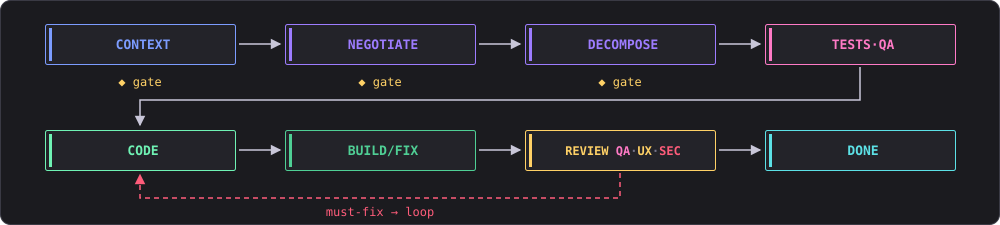
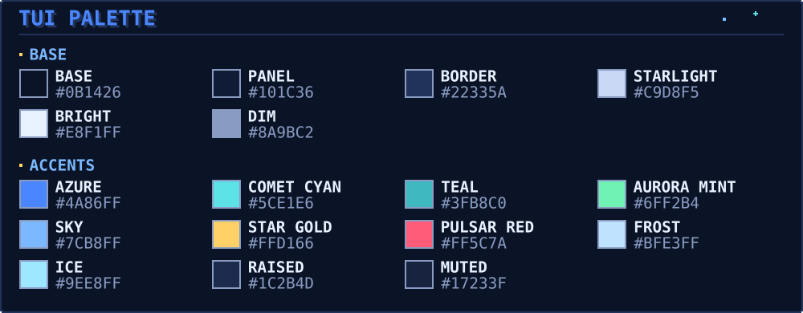

<p align="center">
  
</p>

<p align="center"><b>Decsr Code</b> — command: <code>decsr</code></p>

<p align="center">
  <a href="https://github.com/Decsr/Decsr-Code/blob/main/LICENSE"></a>
  <a href="https://github.com/Decsr/Decsr-Code/releases"></a>
  <a href="https://github.com/Decsr/Decsr-Code/actions/workflows/ci.yml"></a>
  <a href="https://github.com/Decsr/Decsr-Code/blob/main/go.mod"></a>
  <a href="https://pkg.go.dev/github.com/Decsr/Decsr-Code"></a>
</p>

<p align="center">
  <a href="#features">Features</a> ·
  <a href="#install">Install</a> ·
  <a href="#usage">Usage</a> ·
  <a href="#pipeline">Pipeline</a> ·
  <a href="#theme-galaxy--pixel">Theme</a> ·
  <a href="#docs">Docs</a>
</p>

<p align="center"></p>

## What Is It?

Decsr Code (command: `decsr`) is an open-source CLI tool written in Go that drives a team of specialized AI agents through a structured software development pipeline. Instead of chatting with a single LLM, you describe a task in plain text and DECSR runs a full **Context → Spec → Plan → Tests → Implement → Build/Fix → Review → Done** workflow — with human approval gates before any code is written.

It ships with a terminal UI (built with [Bubble Tea](https://github.com/charmbracelet/bubbletea)) and also supports a headless plain-text mode for CI or scripting.

### Why DECSR

Manual back-and-forth with AI coding assistants is slow, error-prone, and hard to reproduce. DECSR:

<table>
  <tr>
    <td width="50%" valign="top">✦ <b>Structures the work</b><br>into well-defined phases so nothing gets skipped.</td>
    <td width="50%" valign="top">✦ <b>Runs multiple specialist agents</b><br>(PM, Coder, QA, UX Reviewer, Security Auditor) — each with its own prompt, skills, and model.</td>
  </tr>
  <tr>
    <td width="50%" valign="top">✦ <b>Iterates automatically</b><br>— if tests fail or reviewers find must-fix issues, the Coder fixes and the entire quality gate restarts.</td>
    <td width="50%" valign="top">✦ <b>Keeps humans in the loop</b><br>— approval gates let you review and revise the task spec and execution plan before any code is written.</td>
  </tr>
</table>

<p align="center"></p>

## Features

### 5 Specialized Agents

| Agent | Role |
|-------|------|
|  | Negotiates the task spec, decomposes work into sub-tasks, and arbitrates review feedback |
|  | Writes and fixes code, runs builds and tests |
|  | Generates tests (TDD), verifies test runs, and reviews code quality, logic, and corner cases |
|  | UX/UI heuristic review |
|  | Security audit and vulnerability scanning |

### Workspace

`decsr` opens one screen: the node graph with a prompt under it. Describe a
task, a lead agent splits it into sub-tasks shown as a node graph, you assign a
role to each node, and assigned nodes run in parallel (3 at a time by default).
A final **Build & test** node checks the result. Nothing runs until you press
`r` or `R`. Roles are plain data (a name, a description and a model), so you can
add your own under `agents:` in `.decsr/project.yaml`. In a git repository each
node runs in its own worktree and branch; `/merge` brings the result into your
checkout (`workspace.isolation: shared` turns this off).
From 100 columns a sidebar lists the nodes and saved sessions beside an
activity feed with one card per node (`g` switches to the graph); see
[`doc/workspace.md`](doc/workspace.md#layout).

**Start from an issue:** `/issue <N|URL|bead-id>` (or `decsr issue <ref>`) sends a GitHub issue or a bead to the lead as the task; the pull request then says `Closes #N` (see [`doc/workspace.md`](doc/workspace.md#start-from-an-issue)).

**Import from Spec Kit:** `/import speckit [--phase N] [path]` adds the open tasks of a Spec Kit `tasks.md` to the graph with phase and `[P]` dependencies finished nodes tick their task back in `tasks.md`, and a `tasks.md` with open tasks is detected on start (see [`doc/workspace.md`](doc/workspace.md#import-from-spec-kit)).

**Diff and review notes:** `d` on a node shows what it changed (`D` the whole session); `c` puts a note on a line and `S` sends the notes to the agent as a new node (see [`doc/workspace.md`](doc/workspace.md#diff-and-review-notes)).

**Agent mode:** `mode: agent` lets Claude, OpenCode or Codex edit files in the node's worktree with their own tools (Claude only gets a fixed tool list), `mode: text` keeps the file blocks; `!` on a node opens a shell in its worktree (see [`doc/workspace.md`](doc/workspace.md#agent-mode)).

**Reply to a node:** `@T3 <message>` in the prompt (`@` completes node IDs) or `m` on a node starts a new attempt of that node with your message, keeps the earlier attempts, and queues the reply while the node runs (see [`doc/workspace.md`](doc/workspace.md#reply-to-a-node)).

**Node reports:** every workspace node ends with a `REPORT` (`status: done | blocked | question`); a node that asks a question or is blocked ends `◇ waiting` until you reply to it (see [`doc/workspace.md`](doc/workspace.md#node-reports-and-waiting-nodes)).

**Coordinator mode:** `workspace.coordinator: true` or `/coordinator on` makes the lead review each finished batch and propose adding, changing or cancelling nodes: a card with `y`/`n` at level 1, applied with `auto ›` lines at level 2 and 3, at most 5 reviews per task (see [`doc/workspace.md`](doc/workspace.md#coordinator-mode)).

**Cost and budget:** add `pricing:` to the config and set `workspace.budget_usd`; the Workspace shows cost in a bottom bar, warns at 80% and stops starting nodes at the budget; `/budget` shows the spending (see [`doc/workspace.md`](doc/workspace.md#cost-and-budget)).

**Autonomy levels:** `workspace.autonomy` or `/autonomy 1|2|3` lets the Workspace accept roles, run, add fix nodes after a failed Build & test (level 2) and open and watch the pull request (level 3, needs a budget); it never merges (see [`doc/workspace.md`](doc/workspace.md#autonomy-levels)).

**Pull requests:** `/pr` pushes the session branch and opens a pull request with `gh`; `/pr watch` turns failing CI and review comments into fix nodes (see [`doc/workspace.md`](doc/workspace.md#pull-requests)).

**Needs-you notifications:** when a split waits for roles, a node or Build &
test fails or passes, or a run ends, DECSR rings the terminal bell, sends a
desktop notification and can post to an ntfy, Slack or Discord webhook
(`notifications.webhook`). See [`doc/workspace.md`](doc/workspace.md#notifications).

Each project keeps its own sessions in `.decsr/sessions/`: `decsr resume` (or
`/resume`) continues one, `/clear` starts a new one, `/compact` folds finished
nodes into a summary. `/profile` saves the role settings once in
`~/.decsr/profiles/` and applies them to any project, `/project` switches
project, and markdown files in `.decsr/commands/` and `.decsr/skills/` add your
own `/commands` and role skills. Claude-format plugins in `.decsr/plugins/` add
commands, skills and agent roles (`/plugin`). The classic pipeline stays available from the
Home menu (`/config`). See [`doc/workspace.md`](doc/workspace.md).

### Interactive TUI

Terminal user interface built around a **Workflow Cockpit**: a phase
spine with the subtask tree, an Activity-first work pane, and a run inspector for
gates, tokens, tests, agents, and changes. Live token streaming, artifact viewer,
chat-based revision, and project picker are included.

The cockpit removes host CPU/memory/network metrics. It focuses on how the work is
decomposed, which agent owns each subtask, what they are doing, and where the
tokens went. Tokens are shown per agent and per subtask; a trailing `~` marks an
estimated count.

See [`doc/tui.md`](doc/tui.md) for the full reference of panes, tabs, status
indicators, keyboard shortcuts, and token notation.

### Configurable LLM Backends

Supports multiple runners out of the box:

**CLI runners** (drive an external coding-agent CLI):

- **OpenCode** (default)
- **Claude CLI** (pick an alias such as `fable` or `opus`, a full model name, or type a model id; with no model set, `claude-opus-5-5` with high effort is used)
- **Codex CLI**
- **GitHub Copilot CLI**

**Local model backends** (talk to a local OpenAI-compatible server):

- **Ollama** (`http://127.0.0.1:11434`)
- **LM Studio** (`http://127.0.0.1:1234`)
- **oMLX** (Apple Silicon, `http://127.0.0.1:8000`)

**API runners** (OpenAI-compatible HTTP APIs, text mode: plain chat completion, no tools):

- **DeepSeek** (`deepseek`), **OpenAI** (`openai`), **OpenRouter** (`openrouter`), **Groq** (`groq`) — presets with a default base URL and key variable
- **Custom** — any provider with a chat completions API (Together, a self-hosted gateway); `runner: openai` with `base_url`, or a saved custom provider

Connect a provider once and decsr keeps the key for you:

```bash
decsr connect deepseek          # asks for the key (hidden), tests it, saves it
echo "$KEY" | decsr connect groq    # or pipe the key; it is never a command-line argument
decsr connect --list            # saved providers with masked keys, plus keys set in the environment
decsr disconnect deepseek       # delete a saved key
```

`decsr connect` tests the key with `GET <base_url>/models`, saves it in `~/.decsr/credentials.json` (directory `0700`, file `0600`; decsr refuses a file that is readable by others) and asks whether the lead, all roles or nothing should use the provider. In the Workspace use `/connect`, and in `/config` press `k` on an API provider. Providers (including saved custom ones and `+ custom…`) and base URLs (`u`) can also be set in `/config`.

The alternative is an environment variable: `export DEEPSEEK_API_KEY=...` (`OPENAI_API_KEY`, `OPENROUTER_API_KEY`, `GROQ_API_KEY`). The key is looked up in this order: the environment variable (`api_key_env`, else the preset's), then the saved credential. The key is never written to a yaml config; `decsr doctor` shows where each key comes from.

```yaml
agents:
  coder:
    runner: deepseek
    model: deepseek-v4-flash   # optional, this is the default
  qa:
    runner: openai
    base_url: https://openrouter.ai/api/v1
    api_key_env: OPENROUTER_API_KEY
    model: deepseek/deepseek-chat
  docs:
    runner: openai
    provider: acme             # a custom provider saved with `decsr connect custom`; its base URL is used
    model: acme-large
```

`base_url`, `api_key_env` and `model` in the config override the preset. `openai` and the other presets without a default model need `model`.

Each agent can use a different runner and model — configure globally (`~/.decsr/config.yaml`) or per-project (`.decsr/project.yaml`).

### Human Approval Gates

The pipeline pauses for your approval before any code is written:
- **Repository context pack** — the PM reads the repository and writes a compact Markdown briefing (`.decsr/context_pack.md`) with a user-editable section for extra text, notes, and URLs. Review, edit, and approve it before planning starts. See [`doc/context-pack.md`](doc/context-pack.md) for the format and configuration.
- **Task spec** — title, scope, and description negotiated with the PM
- **Execution plan** — the decomposition into sub-tasks (`task_plan.md`), pre-reviewed by Security and QA

You can review, revise via chat, and approve — all from the TUI.

<details>
<summary><b>Layered Configuration</b> — three-layer config with sensible defaults</summary>

<br>

Three-layer config with sensible defaults:

1. **Built-in defaults** — the language is auto-detected from marker files (Go, C/C++ with CMake, C#/.NET, Java, Python, Rust, JS/TS, Ruby, Elixir) and can be overridden with `project.language`
2. **Global user config** (`~/.decsr/config.yaml`) — your preferred models, runners, and reasoning effort
3. **Project config** (`.decsr/project.yaml`) — project-specific overrides (language, test commands, scoping)

Each agent can set a reasoning effort next to its runner and model:

```yaml
agents:
  coder:
    runner: opencode
    model: opencode/gpt-5.3-codex
    effort: high
```

Effort levels depend on the model/provider (for example `low`, `medium`,
`high`, `xhigh`, `max`); `effort: default` leaves the choice to the provider.
The TUI's setup screens show only the levels the selected model supports.

</details>

<details>
<summary><b>Local Model Memory Cap</b> — bound RAM / context for Ollama, LM Studio, oMLX</summary>

<br>

When running local models (Ollama, LM Studio, oMLX), the **Model Memory** screen lets you bound resource use: pick a **RAM limit** (auto-converted to a per-agent context window based on the model and your system RAM) or a fixed **context-token limit** applied verbatim to every agent. This keeps large local models from exhausting memory.

</details>

<details>
<summary><b>Skills System</b> — embedded skill documents injected into agent prompts</summary>

<br>

Agents are augmented with embedded skill documents (Go patterns, testing strategies, security checklists, etc.) that are injected into their system prompts.

</details>

<details>
<summary><b>Project Memory</b> — Markdown files in <code>.decsr/memory/</code></summary>

<br>

DECSR persists everything important about a project as Markdown files in `.decsr/memory/`:

- **`MEMORY.md`** — pinned facts and decisions, prepended verbatim to every agent prompt.
- **`memory/daily/YYYY-MM-DD.md`** — auto-appended event log per pipeline run.
- **`memory/tasks/<task-id>.md`** — per-task summary on completion.

Files are indexed into a local SQLite database (FTS5/BM25) so a new task recalls relevant fragments from past work. Optional embedder backends (OpenAI-compatible, Ollama) enable hybrid semantic search. See [`doc/memory.md`](doc/memory.md) for details.

```bash
decsr memory show
decsr memory search "JWT auth"
decsr memory add "Use sqlc for typed queries"
```

</details>

<p align="center"></p>

## Pipeline

<p align="center">
  
</p>

<details>
<summary><b>How the pipeline works</b></summary>

<br>

### Pipeline Algorithm

DECSR runs a deterministic, resumable pipeline:

1. **Collect context** — scans the project (greenfield vs. brownfield, language, toolchain) and recalls relevant fragments from project memory.
2. **Compact context** *(human gate)* — the **PM** reads the repository and writes `.decsr/context_pack.md`: architecture, key files, commands, conventions, risks, and a **user-editable section** for extra text, notes, and URLs. You edit and approve it, then the PM asks what you want to do.
3. **Negotiate** *(human gate)* — the **PM** turns your task request into a structured `TaskSpec`; you approve or re-negotiate via chat.
4. **Decompose** *(human gate)* — the **PM** splits the spec into ordered sub-tasks. The plan is pre-reviewed by **Security** and **QA**, then rendered to `task_plan.md` for your approval. Sub-tasks are tracked as **beads** (durable issues) so the run is resumable.
5. **Implement + Quality Review loop** *(autonomous, capped iterations)*:
   - **Phase A — Tests first (TDD):** **QA** writes tests for *all* sub-tasks before any implementation.
   - **Phase B — Implement:** the **Coder** implements every sub-task in bead order.
   - **Phase C — Global build/test/fix:** one project-wide build → test → fix loop after all sub-tasks are implemented.
   - **Phase D — Quality review:** **QA**, **UX Reviewer**, and **Security** review the result. The **PM** arbitrates all feedback in a single verdict; must-fix issues become new beads and the loop restarts. Nice-to-haves are deferred.
6. **Finalize** — emits a summary and `nice_to_have.md`, updates project memory, closes the beads, and clears resume state.

Any interrupted run can be resumed: DECSR reloads the spec and sub-task plan, re-establishes build/test state, and finishes the remaining open beads without re-negotiating.

See [`doc/context-pack.md`](doc/context-pack.md) for the context pack format, editing flow, and configuration.

</details>

<p align="center"></p>

## Install

### Prerequisites

- **Go 1.26+**
- **Git** repository to work in
- A monospace terminal font — [Monaspace Krypton](https://monaspace.githubnext.com) is recommended for the TUI
- At least one LLM backend installed and configured — a CLI runner (**OpenCode**, **Claude CLI**, **Codex CLI**, or **GitHub Copilot CLI**) or a local model server (**Ollama**, **LM Studio**, or **oMLX**)
- **[bd (beads)](https://github.com/gastownhall/beads)** — recommended. Sub-tasks are tracked as durable beads, which makes runs resumable across sessions. Without `bd` the pipeline still runs, but multi-session resume of a bead-backed task is unavailable.

### Option 1 — One-line install (Linux, macOS)

```bash
curl -fsSL https://raw.githubusercontent.com/Decsr/Decsr-Code/main/scripts/install.sh | sh
```

Installs the latest release to `~/.local/bin` (no sudo) after verifying its checksum. Set `DECSR_VERSION=v0.6.0` to pin a release or `DECSR_INSTALL_DIR` to change the directory.

Then run `decsr doctor` to check your setup: git, config, runners and API keys, plus optional tools such as `tmux` and `gh`. It prints a fix hint for every problem and exits with 1 if a required check fails.

### Option 2 — Homebrew (once the tap is published)

```bash
brew install decsr/tap/decsr
```

### Option 3 — Prebuilt binaries

Download an archive for Linux, macOS or Windows (amd64/arm64) from the [Releases page](https://github.com/Decsr/Decsr-Code/releases), unpack it and put `decsr` on your `PATH`.

### Option 4 — `go install`

```bash
go install github.com/Decsr/Decsr-Code/cmd/decsr@latest
```

### Option 5 — From source

```bash
# Clone and build
git clone https://github.com/Decsr/Decsr-Code.git
cd Decsr-Code
make build install

# Verify
decsr help
```

<p align="center"></p>

## Usage

**Interactive mode** — launch the Workspace: type a task, assign agents to the nodes, run them (`/config` opens the classic pipeline and requirements picker):

```bash
cd /path/to/your/project
decsr            # new session
decsr resume     # pick a saved session of this project
```

Or, from this repository:

```bash
make run
```

**Detached runs** — keep decsr alive when the terminal closes or SSH drops (needs tmux):

```bash
decsr --tmux       # runs decsr in a tmux session "decsr-<project>-<hash>" and attaches
decsr ls           # list running decsr sessions
decsr attach       # come back (name or project path optional)
```

Detach with the tmux prefix then `d` (`Ctrl+b d` by default). Set `ui.tmux: true` to make plain `decsr` do this.

**Task from a description** — opens the TUI by default:

```bash
decsr task --description "Add JWT auth to the login endpoint"
```

**Headless mode** — plain-text output for CI or scripting:

```bash
decsr task --description "Add JWT auth to the login endpoint" --ui plain
```

**From a file:**

```bash
decsr task --from-file task.md
```

**On a feature branch:**

```bash
decsr task --description "Add JWT auth to the login endpoint" --branch feat/my-feature
```

**Legacy greenfield workflow:**

```bash
decsr run --requirements requirements.md
```

<p align="center"></p>

## Theme: Galaxy × Pixel

A deep-space navy base with starlight text and azure, comet and star-gold accents.

<p align="center">
  
</p>

**Role legend:** PM azure `#4a86ff` · Coder comet cyan `#5ce1e6` · Coder fixer teal `#3fb8c0` · QA sky `#7cb8ff` · UX frost `#bfe3ff` · Security star gold `#ffd166` · PR ice `#9ee8ff`. Errors use pulsar red `#ff5c7a`, passing tests use aurora mint `#6ff2b4`, and gates use star gold.

<p align="center"></p>

## Docs

- [`doc/workspace.md`](doc/workspace.md) — Workspace: node graph, sessions, profiles, commands, roles, keys, and parallel runs
- [`doc/tui.md`](doc/tui.md) — workflow cockpit: panes, tabs, gates, keyboard shortcuts, and token notation
- [`doc/memory.md`](doc/memory.md) — project memory details
- [`doc/context-pack.md`](doc/context-pack.md) — context pack format, editing flow, and configuration

## Development

```bash
make build      # build bin/decsr
make test       # run the test suite
make lint       # vet and lint
```

### Demo GIF

`make demo` records `doc/assets/demo.gif` from [`doc/demo.tape`](doc/demo.tape)
with [vhs](https://github.com/charmbracelet/vhs). Install it with
`go install github.com/charmbracelet/vhs@latest`; it also needs `ttyd` and
`ffmpeg` on the PATH, and the Monaspace Krypton font. The tape drives a real
session: run `DECSR_DEMO_DIR=/path/to/small/git/project make demo` from this
repository, with a cheap, fast model configured, and tune the `Sleep` timings to it. Model output is not
deterministic.

<p align="center"></p>

<p align="center">
  <a href="LICENSE">MIT</a> © DECSR<br>
  <sub>✦ built in the terminal ✦</sub>
</p>
